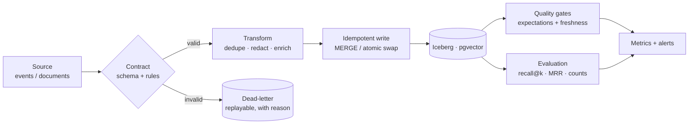
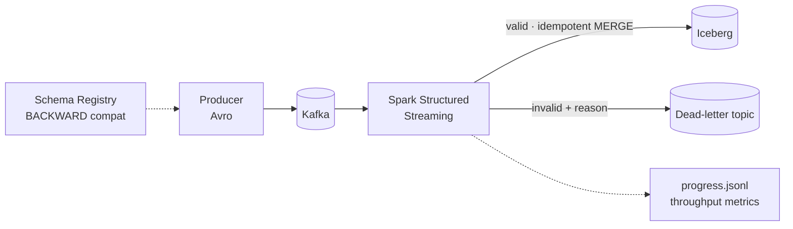
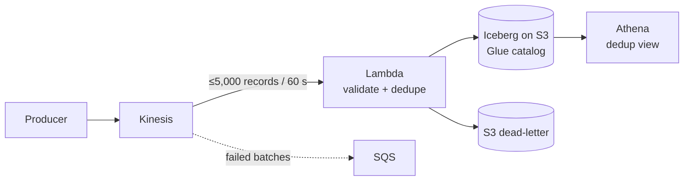
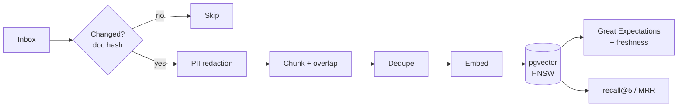
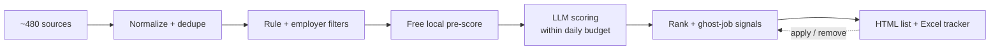

 

**[About](#about)** &nbsp;·&nbsp; **[At a glance](#at-a-glance)** &nbsp;·&nbsp; **[How I build](#how-i-build-pipelines)** &nbsp;·&nbsp; **[Projects](#featured-projects)** &nbsp;·&nbsp; **[Skills](#skills)** &nbsp;·&nbsp; **[Next](#whats-next)** &nbsp;·&nbsp; **[Connect](#lets-connect)**

---

## About

I'm a **Data Engineer** focused on batch and streaming pipelines, lakehouse storage, and the data foundations behind **retrieval-augmented generation (RAG)** systems. I care about the parts that make data trustworthy in production: **data contracts, idempotent writes, dead-letter handling, quality gates, and measurable evaluation**.

My projects are built to be run, not just read. Each one has tests, CI or a reproducible local setup, and a results section that says what was measured and what was only estimated.

<table>
<tr>
<td width="50%" valign="top">

**What I work on**
- Streaming ingestion with Kafka, Kinesis and Spark Structured Streaming
- Open table formats (Apache Iceberg) on S3 and local catalogs
- Data layers for RAG: PII redaction, dedup, embeddings, pgvector
- Infrastructure as code and CI for data pipelines

</td>
<td width="50%" valign="top">

**Ask me about**
- Exactly-once outcomes from at-least-once delivery
- Schema evolution and registry compatibility rules
- Retrieval evaluation with recall@k and MRR
- Evaluating fine-tuned language models honestly

</td>
</tr>
</table>

---

## At a glance

<table>
<tr>
<td align="center" width="25%"><h2>5</h2>end-to-end projects streaming, lakehouse, RAG, ML, LLM ranking</td>
<td align="center" width="25%"><h2>144</h2>unit tests across the two streaming pipelines</td>
<td align="center" width="25%"><h2>9,830</h2>job postings processed in the first 4 days of Job Finder</td>
<td align="center" width="25%"><h2>−56%</h2>held-out perplexity after fine-tuning GPT-2 Small</td>
</tr>
</table>

---

## How I build pipelines

The same reliability pattern shows up across my streaming and RAG projects. This is the reference design I reuse:

| Principle | How it shows up | Where |
|:--|:--|:--|
| **Contracts before code** | Avro + Schema Registry with BACKWARD compatibility; breaking changes are rejected | Claims pipeline |
| **Never drop, never duplicate** | Dead-letter topic/bucket for bad data; idempotent `MERGE` and dedup views for replays | Claims, Lakehouse |
| **Quality is a gate, not a report** | Great Expectations and freshness checks fail the DAG | RAG pipeline |
| **Cost-aware by design** | Batched writes, partition pruning, Athena bytes-scanned cutoff | Lakehouse |
| **Measure it, and say what it means** | Retrieval metrics, labeled caveats on which results generalize | RAG, ML-DriftNet |
| **Reproducible** | Terraform, Docker Compose, Makefiles, CI | All |

---

## Featured projects

> Click a project to expand its architecture and highlights.

<b>🌊 Real-Time Claims Event Pipeline</b> &nbsp;·&nbsp; Kafka → Spark Structured Streaming → Iceberg

 

A streaming pipeline for health-insurance claim events with the data contract enforced by Confluent Schema Registry. Runs locally in Docker on synthetic data.

- **Data contract:** a compatible schema change is accepted; a breaking one is rejected by the registry
- **Bad data handling:** every record is checked for wire format, schema ID, Avro decode and 9 business rules; failures keep their original bytes and an error code so they can be replayed
- **Delivery:** at-least-once checkpoints plus `MERGE ... WHEN NOT MATCHED` on `claim_event_id`, so replays never duplicate rows
- **Testing:** 86 unit tests and a parity test that checks Spark rule expressions against the Python rules

`Kafka` `Spark Structured Streaming` `Apache Iceberg` `Avro` `Schema Registry` `Docker`

**[View repository →](https://github.com/rugweshreddygankidi-stack/realtime-claims-event-pipeline)**

<b>🏔️ AWS Serverless Streaming Lakehouse</b> &nbsp;·&nbsp; Kinesis → Lambda → Iceberg on S3 → Athena

 

A fully serverless clickstream pipeline with all infrastructure defined in Terraform.

- **Cost control:** one Athena `INSERT` per batch instead of per record, partitioning by `event_date`, and a workgroup bytes-scanned cutoff
- **Failure isolation:** bisect-on-error plus an SQS failure destination so a poison record cannot block a shard
- **Correctness:** an `events_dedup` view guarantees one row per `event_id` despite at-least-once delivery
- **Engineering:** 58 pytest cases, GitHub Actions CI, cost-allocation tags on every resource

`AWS Kinesis` `Lambda` `Iceberg` `Athena` `Glue` `SQS` `Terraform` `pytest`

**[View repository →](https://github.com/rugweshreddygankidi-stack/aws-serverless-streaming-lakehouse)**

<b>🧠 RAG Data Pipeline</b> &nbsp;·&nbsp; Airflow + PostgreSQL/pgvector

 

The data-engineering half of a RAG system. It does not call an LLM; it makes the retrieval layer trustworthy.

- **Incremental:** hourly DAG processes only documents whose hash changed; changed documents are replaced in one transaction
- **Privacy:** emails, SSNs, phone numbers and Luhn-valid card numbers are redacted before chunking and embedding
- **Quality gates:** Great Expectations checks plus a freshness check that fails the DAG
- **Evaluation:** a daily DAG computes recall@5 and MRR on a labeled known-item benchmark and can fail below a threshold

`Airflow` `pgvector` `PostgreSQL` `Great Expectations` `fastembed` `Docker`

**[View repository →](https://github.com/rugweshreddygankidi-stack/rag-data-pipeline)**

<b>🔬 ML-DriftNet</b> &nbsp;·&nbsp; Domain adaptation of GPT-2 (Master's team project, project lead)

 

UMass Dartmouth, DSC 550, Spring 2026. Does fine-tuning GPT-2 Small (124M parameters) on 1,493 structured ML Q&A pairs produce measurable domain adaptation? Evaluated against the baseline with a five-metric framework.

| Metric | GPT-2 baseline | Fine-tuned |
|:--|:--:|:--:|
| Perplexity on held-out Q&A | 72.85 | **31.83** (−56.1%) |
| Multiple-choice answer ranking | 26.7% | **86.7%** |
| Log-probability per token | −4.48 | **−2.92** |

- Held-out perplexity is the cleanest evidence: lower on all 20 pairs never seen in training
- The write-up states which metrics reuse training questions, so the generalization claim is not overstated
- Trained on a Colab T4 GPU in about 4.5 minutes with fp16 autocast and gradient checkpointing

`PyTorch` `Hugging Face` `Colab` `Evaluation design`

**[View repository →](https://github.com/rugweshreddygankidi-stack/ml-driftnet)** &nbsp;·&nbsp; **[Interactive results report →](https://rugweshreddygankidi-stack.github.io/ml-driftnet/results/research_report.html)**

<b>🎯 Job Finder</b> &nbsp;·&nbsp; Multi-source collection + LLM ranking (source private, case study public)

 

A daily pipeline that collects postings from about 480 career sites and job boards, deduplicates and filters them, scores them against a resume with LLM APIs under a daily budget planner, and learns from apply/remove decisions.

- **First 4 days of real use:** 9,830 postings from 4,064 companies → 91% removed by rule filters → 168 shown in ranked lists
- **Engineering:** about 7,400 lines of Python; an offline end-to-end test checks 51 behaviors in CI
- **Budgeting:** a planner splits free LLM API quotas across runs so evening runs are never starved

`Python` `SQLite` `pandas` `LLM APIs` `GitHub Actions`

**[View case study →](https://github.com/rugweshreddygankidi-stack/job-finder)** &nbsp;·&nbsp; **[Demo results page →](https://rugweshreddygankidi-stack.github.io/job-finder/results/demo_Todays_Jobs.html)**

---

## Skills

<b>Data engineering core</b>

 

<b>Lakehouse, storage and formats</b>

 

<b>Cloud, infrastructure and delivery</b>

 

<b>Data quality and testing</b>

 

<b>Gen AI and machine learning</b>

 

<b>Where each skill is proven</b> (click to expand)

 

| Skill | Evidence |
|:--|:--|
| Kafka, Schema Registry, Avro | Claims pipeline: contract enforcement, schema-evolution demo, dead-letter topic |
| Spark Structured Streaming | Claims pipeline: decode, validate, idempotent Iceberg `MERGE`, progress listener |
| Iceberg, Glue, Athena, S3 | Lakehouse: partitioned tables, dedup view, bytes-scanned guardrail |
| Terraform, IAM, SQS, Lambda, Kinesis | Lakehouse: complete infrastructure as code with failure isolation |
| Airflow, pgvector, Great Expectations | RAG pipeline: incremental DAG, HNSW index, quality and freshness gates |
| Retrieval evaluation | RAG pipeline: recall@5 and MRR on a labeled benchmark |
| PyTorch, Hugging Face, fine-tuning | ML-DriftNet: GPT-2 Small fine-tune with five-metric evaluation |
| LLM APIs, SQLite, pandas, CI | Job Finder: budget-planned LLM scoring, history database, offline end-to-end test |

---

## What's next

Mostly taken from the "next steps" and "limitations" lists in my own repositories, plus one learning goal:

- [ ] Scheduled Iceberg maintenance (`OPTIMIZE ... REWRITE DATA USING BIN_PACK`, `VACUUM`) and CloudWatch alarms on the lakehouse
- [ ] Schema-id-aware decoding so one Kafka topic can safely carry mixed schema versions
- [ ] Move the claims pipeline from a local catalog to an object-store catalog (Glue, Nessie or REST)
- [ ] LoRA / QLoRA comparison and a larger held-out set for ML-DriftNet
- [ ] Snowflake and dbt modeling layer on top of the lakehouse outputs

---

## Let's connect

I'm looking for **Data Engineering** roles in batch, streaming, lakehouse and Gen AI data platforms.

Massachusetts, USA

