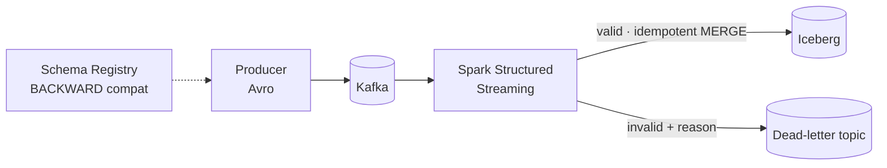
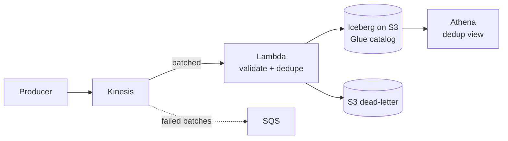
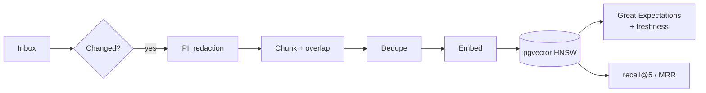

---

## 👋 About

I'm a **Data Engineer** who builds batch and streaming pipelines, lakehouse storage layers, and the data foundations behind **retrieval-augmented generation (RAG)** systems. I care about the unglamorous parts that make data trustworthy: **data contracts, idempotent writes, dead-letter handling, quality gates, and measurable evaluation**.

- 🌊 **Streaming & lakehouse:** Kafka, Spark Structured Streaming, Apache Iceberg, Kinesis, Lambda, Athena
- 🧠 **Gen AI data layers:** ingestion, PII redaction, deduplication, embeddings, pgvector, retrieval evaluation (recall@k, MRR)
- 🏗️ **Infrastructure as code & CI:** Terraform, Docker, GitHub Actions, pytest-first development
- 🎓 **Machine learning:** fine-tuning and rigorous evaluation of language models (Master's coursework, UMass Dartmouth)

---

## 🧰 Tech Stack

| | |
|:--|:--|
| **Languages** |    |
| **Processing & Streaming** |     |
| **Warehouse & Lakehouse** |     |
| **Orchestration & Transformation** |    |
| **Cloud & DevOps** |     |
| **AI / ML** |     |

---

## 🚀 Featured Projects

### 🌊 [Real-Time Claims Event Pipeline](https://github.com/rugweshreddygankidi-stack/realtime-claims-event-pipeline)
**Kafka → Spark Structured Streaming → Apache Iceberg**, with the data contract enforced by Confluent Schema Registry.

- Schema evolution demo: a compatible change is accepted, a breaking change is rejected by the registry
- Every record checked for wire format, schema ID, Avro decode and **9 business rules**; failures are replayable from the dead-letter topic
- **Idempotent `MERGE`** on `claim_event_id`, so replays and restarts never duplicate rows
- 86 unit tests plus a parity test between the Python and Spark rule implementations
- `Kafka` `Spark` `Iceberg` `Avro` `Schema Registry` `Docker`

### 🏔️ [AWS Serverless Streaming Lakehouse](https://github.com/rugweshreddygankidi-stack/aws-serverless-streaming-lakehouse)
**Kinesis → Lambda → Apache Iceberg on S3 → Athena**, fully defined in Terraform.

- Batched writes (5,000 records or 60 s) to control cost and small-file counts
- Bad rows dead-lettered to S3, poison batches isolated with bisect-on-error and an SQS failure destination
- `events_dedup` view guarantees one row per `event_id` despite at-least-once delivery
- Athena workgroup with a bytes-scanned cutoff as a cost guardrail; 58 unit tests and CI
- `AWS` `Terraform` `Iceberg` `Athena` `Glue` `pytest`

### 🧠 [RAG Data Pipeline](https://github.com/rugweshreddygankidi-stack/rag-data-pipeline)
**The data-engineering half of RAG:** Airflow + PostgreSQL/pgvector, focused on making retrieval trustworthy.

- Hourly **incremental** ingestion by document hash; atomic per-document replacement
- PII redaction (emails, SSNs, phones, Luhn-valid cards) before chunking and embedding
- Great Expectations gates, freshness checks, and a daily **retrieval evaluation** DAG (recall@5, MRR)
- `Airflow` `pgvector` `Great Expectations` `Docker` `fastembed`

### 🔬 [ML-DriftNet: Domain Adaptation of GPT-2](https://github.com/rugweshreddygankidi-stack/ml-driftnet)
Master's team project (DSC 550, UMass Dartmouth, Spring 2026), project lead. GPT-2 Small fine-tuned on 1,493 ML Q&A pairs and evaluated against the baseline with a five-metric framework.

| Metric | GPT-2 baseline | Fine-tuned |
|:--|:--:|:--:|
| Perplexity on held-out Q&A | 72.85 | **31.83** (−56.1%) |
| Multiple-choice answer ranking | 26.7% | **86.7%** |
| Log-probability per token | −4.48 | **−2.92** |

- Documents honestly which metrics reuse training questions, so the evidence for generalization is not overstated
- `PyTorch` `Hugging Face` `Colab` `Evaluation design`

### 🎯 [Job Finder](https://github.com/rugweshreddygankidi-stack/job-finder) *(source private, case study public)*
A daily pipeline that collects postings from ~480 career sites and job boards, filters and deduplicates them, scores them against a resume with LLM APIs under a daily budget planner, and learns from apply/remove decisions.

- First 4 days of real use: **9,830 postings → 91% removed by rule filters → 168 shown** in ranked daily lists
- ~7,400 lines of Python; an offline end-to-end test checks 51 behaviors in CI
- `Python` `SQLite` `pandas` `LLM APIs` `GitHub Actions`

---

## 🧭 Engineering Principles

| Principle | In practice |
|:--|:--|
| **Contracts before code** | Schema Registry with backward compatibility; breaking changes fail fast |
| **Never drop, never duplicate** | Dead-letter queues for bad data; idempotent writes for replays |
| **Quality is a gate, not a report** | Expectations and freshness checks fail the pipeline |
| **Measure it** | Retrieval metrics, throughput logs, and results that state their own limits |
| **Reproducible** | Terraform, Docker, Makefiles, and CI so anyone can run it |

---

## 📫 Let's Connect

I'm looking for **Data Engineering** opportunities (batch, streaming, lakehouse, and Gen AI data platforms).

